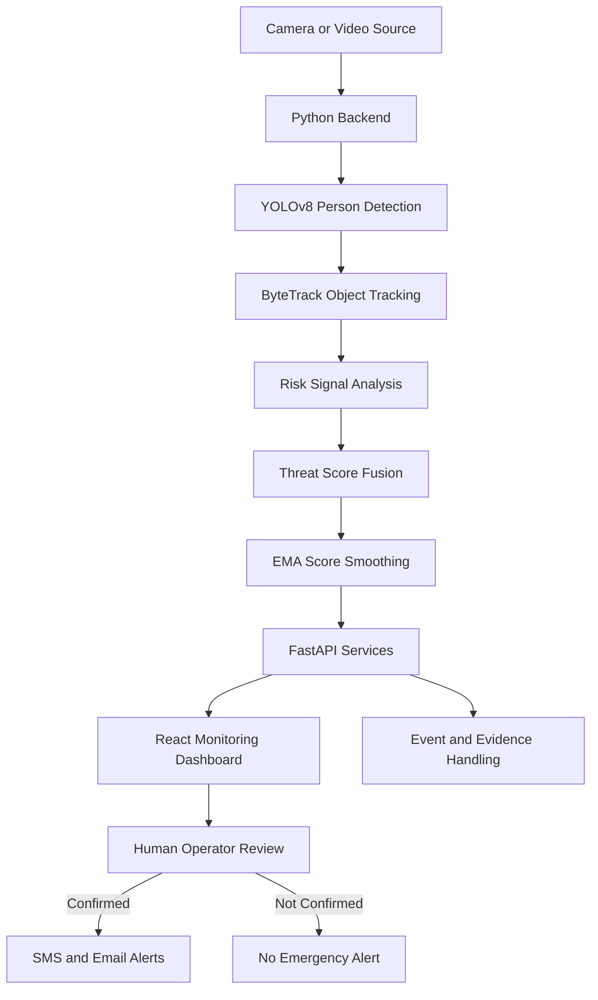

# 🛡️ SheShield — AI-Powered Women's Safety Monitoring

### Real-Time Computer Vision · Intelligent Threat Assessment · Human-Verified Emergency Alerts

SheShield is an AI-powered safety-monitoring prototype designed to help identify potentially risky situations through real-time video analysis. It combines computer vision, multi-signal threat assessment, live monitoring, and human-verified emergency notifications to support faster, more informed safety responses.

The system analyzes camera footage, tracks detected people across video frames, evaluates configured risk signals, and presents the results through a live monitoring dashboard. A human operator must review and confirm an incident before an emergency alert is sent.

**Live Demo:** [sheshield-rho.vercel.app](https://sheshield-rho.vercel.app)

**Repository:** [github.com/Noorulhuda-12/sheshield](https://github.com/Noorulhuda-12/sheshield)

**Project Type:** Final Year Project (FYP)
**Academic Program:** BS Information Technology
**Institution:** Government College University Faisalabad (GCUF)
**Project Year:** 2026

---

## 📌 Table of Contents

* [Overview](#-overview)
* [Problem Statement](#-problem-statement)
* [Our Solution](#-our-solution)
* [Key Features](#-key-features)
* [System Architecture](#-system-architecture)
* [Technology Stack](#-technology-stack)
* [How It Works](#-how-it-works)
* [Project Structure](#-project-structure)
* [Getting Started](#-getting-started)
* [Configuration](#-configuration)
* [Usage](#-usage)
* [Threat Assessment](#-threat-assessment)
* [Privacy and Security](#-privacy-and-security)
* [Testing and Evaluation](#-testing-and-evaluation)
* [Current Limitations](#-current-limitations)
* [Future Enhancements](#-future-enhancements)
* [Contributing](#-contributing)
* [Disclaimer](#-disclaimer)
* [Author](#-author)

---

## 🎯 Overview

Women's safety remains an important social and technological challenge. Conventional surveillance systems often depend on continuous manual observation, making it difficult for operators to notice every potentially concerning event in real time.

SheShield explores how artificial intelligence and computer vision can assist human operators by analyzing video streams, tracking people, evaluating configured safety signals, and highlighting situations that may require attention.

The project combines automated video analysis with a human-in-the-loop alert workflow. Instead of allowing an algorithm to make the final decision, SheShield presents information to an operator who reviews the situation before confirming an alert.

### Project Objectives

* Explore real-time person detection and multi-object tracking.
* Analyze configured visual or behavioral signals associated with potentially risky situations.
* Combine multiple signals into a smoothed threat-assessment score.
* Provide a centralized dashboard for monitoring camera streams and risk indicators.
* Support human-reviewed SMS and email notifications.
* Investigate privacy-conscious evidence handling.
* Build a modular prototype that can be evaluated and improved through controlled testing.

---

## 🚨 Problem Statement

Traditional CCTV systems primarily record video for human review. Monitoring multiple camera feeds simultaneously can be demanding, and important events may be overlooked.

Common challenges include:

* **Continuous monitoring:** Operators must watch multiple video streams for extended periods.
* **Delayed awareness:** Potentially concerning situations may not be noticed immediately.
* **Limited context:** A single video frame may not provide enough information to understand an evolving situation.
* **Alert fatigue:** Reacting to every unusual movement can generate unnecessary notifications.
* **Response coordination:** Operators need a clear way to review an event and initiate an appropriate response.
* **Privacy concerns:** Video surveillance must be handled responsibly, with appropriate access controls and retention policies.

SheShield investigates whether computer vision and multi-signal assessment can help address these challenges while keeping people responsible for reviewing and confirming incidents.

---

## 💡 Our Solution

SheShield uses an AI-assisted monitoring pipeline to transform camera footage into information that a human operator can review.

The prototype follows this workflow:

1. Receive video from a configured camera source.
2. Detect people in video frames using YOLOv8.
3. Track detected people across frames using ByteTrack.
4. Analyze the risk signals implemented in the system.
5. Combine the signals into an overall threat-assessment score.
6. Smooth score changes using an Exponential Moving Average (EMA).
7. Display live camera feeds and risk indicators on a React dashboard.
8. Allow an operator to review and confirm a potential incident.
9. Send configured SMS or email notifications after confirmation.

The purpose is to assist monitoring and decision-making, not to automatically determine that a person has committed wrongdoing.

---

## ✨ Key Features

### 1. Real-Time Person Detection

Uses the YOLOv8 computer vision model to detect people in video frames.

Person detection provides the initial visual information used by subsequent tracking and analysis stages.

### 2. Multi-Object Tracking

Uses ByteTrack to associate detections across consecutive frames.

Tracking helps the system maintain consistent track identifiers as people move through a camera's field of view.

### 3. Multi-Signal Threat Assessment

Combines the risk signals implemented in the backend into a unified assessment.

Each signal can be presented separately so that an operator can better understand which factors contributed to the overall score.

> A risk score is an indication for further review, not proof that a threat exists.

### 4. Temporal Score Smoothing

Uses an Exponential Moving Average (EMA) to reduce sudden fluctuations in the threat score.

This helps prevent a single noisy frame from dominating the displayed assessment.

### 5. Live Monitoring Dashboard

The React dashboard provides a centralized interface for monitoring video streams and associated risk indicators.

The dashboard is designed to make relevant information easier to review without requiring operators to inspect every frame manually.

### 6. MJPEG Video Streaming

Uses Motion JPEG (MJPEG) streams to display live camera footage in the dashboard, where configured and supported.

### 7. Human-Verified Emergency Alerts

Integrates with configured notification services to support SMS and email alerts.

An operator must confirm a potential incident before the notification workflow proceeds.

### 8. Privacy-Conscious Evidence Handling

The project explores minimizing the amount of stored surveillance footage.

Evidence capture, access, and retention should be limited to what is necessary for the prototype's intended purpose and configured policies.

---

## 🏗️ System Architecture

SheShield separates video processing, risk assessment, the monitoring interface, and notification handling into distinct stages.



### Architecture Components

| Component             | Responsibility                                         |
| --------------------- | ------------------------------------------------------ |
| Video input           | Supplies footage for analysis                          |
| YOLOv8                | Detects people in video frames                         |
| ByteTrack             | Associates detections across frames                    |
| Risk analysis         | Calculates the configured risk signals                 |
| Threat fusion         | Combines signals into an overall assessment            |
| EMA smoothing         | Reduces short-term score fluctuations                  |
| FastAPI               | Provides backend services and processing integration   |
| React                 | Displays the monitoring interface                      |
| SQLite                | Provides the default database option, where configured |
| Notification services | Support SMS and email after operator confirmation      |

The precise division of responsibilities between API endpoints, background processing, storage, and the dashboard should be documented as the implementation evolves.

---

## 🛠️ Technology Stack

| Technology     | Purpose                                                                    |
| -------------- | -------------------------------------------------------------------------- |
| Python         | Backend development and video-processing logic                             |
| FastAPI        | Backend API framework                                                      |
| YOLOv8         | Person detection                                                           |
| ByteTrack      | Multi-object tracking                                                      |
| React          | Interactive monitoring dashboard                                           |
| JavaScript     | Frontend application logic                                                 |
| SQLite         | Lightweight database option                                                |
| MJPEG          | Live video streaming                                                       |
| Twilio         | SMS notification integration                                               |
| Email service  | Email notification integration                                             |
| MediaPipe      | Additional computer-vision utilities, where used                           |
| DeepFace       | Facial-analysis library, where used                                        |
| Git and GitHub | Version control and project collaboration                                  |
| Vercel         | Hosting for the linked dashboard/demo, subject to deployment configuration |

**Important:** A library being part of the project environment does not necessarily mean every feature it supports is active. Only describe MediaPipe, DeepFace, or other optional integrations as operational if the current code actually uses them.

---

## 🔄 How It Works

### Step 1 — Video Input

The system receives footage from a supported camera or configured video source.

The input is passed to the backend for processing.

### Step 2 — Person Detection

YOLOv8 processes video frames and identifies detected people.

The output contains detection information used by the tracking stage.

### Step 3 — Object Tracking

ByteTrack associates detections between frames.

This provides continuity across frames and helps the system analyze movement over time.

### Step 4 — Risk Signal Analysis

The backend evaluates the signals that are implemented and enabled in the project.

Each signal contributes information to the subsequent threat-assessment stage. The exact signals and their definitions should match the current implementation.

### Step 5 — Threat Score Fusion

The system combines the configured signals into an overall score.

The score represents the system's assessment under its current rules and model configuration. It is not a verified probability that an incident will occur.

### Step 6 — EMA Smoothing

The score is smoothed over time to reduce abrupt changes caused by individual frames or noisy measurements.

A general EMA formulation is:

$$
S_t = \alpha R_t + (1-\alpha)S_{t-1}
$$

Where:

* \(S_t\) is the current smoothed score.
* \(R_t\) is the current raw score.
* \(S_{t-1}\) is the previous smoothed score.
* \(\alpha\) is the smoothing factor between 0 and 1.

The actual smoothing factor and initialization method should be documented from the implementation.

### Step 7 — Dashboard Visualization

The React dashboard displays the available camera feeds and associated monitoring information.

The interface allows an operator to review a potential incident and its supporting indicators.

### Step 8 — Human Review and Notification

The operator decides whether the event warrants an alert.

Only after confirmation should the configured notification workflow send an SMS or email.

This human-review step is an important safeguard against treating automated assessments as definitive conclusions.

---

## 📁 Project Structure

The repository currently contains a frontend folder named `sheshield-guard`. Use the following as a conceptual structure, then update it to match the actual files and folders in your repository.

```text
sheshield/
├── sheshield-guard/       # React monitoring dashboard
├── README.md              # Project documentation
├── package-lock.json      # Root-level npm lockfile, if applicable
├── requirements.txt       # Backend Python dependencies, if present
├── .gitignore             # Files excluded from version control
├── .env.example           # Example environment configuration
└── docs/                  # Optional architecture and testing documentation
```

If the backend is maintained in another directory or repository, document its real location and link to it instead of implying that it exists in this repository.

A more detailed structure can be added once the actual backend modules, API routes, frontend components, and tests have been verified.

---

## 🚀 Getting Started

Follow these steps to prepare a local development environment. The commands below assume that the backend has a Python dependency file and the frontend is an npm-based React application.

### Prerequisites

Install the following tools:

* Git
* Python version supported by the backend dependencies
* Node.js and npm versions supported by the frontend
* A supported camera or test video source
* Optional credentials for configured notification services

### 1. Clone the Repository

```bash
git clone https://github.com/Noorulhuda-12/sheshield.git
cd sheshield
```

### 2. Set Up the Python Backend

Create and activate a virtual environment.

**Windows PowerShell:**

```powershell
python -m venv .venv
.\.venv\Scripts\Activate.ps1
```

**macOS or Linux:**

```bash
python3 -m venv .venv
source .venv/bin/activate
```

Install dependencies if `requirements.txt` exists in the backend directory:

```bash
pip install -r requirements.txt
```

Start the FastAPI application from the directory containing the actual `main.py` module:

```bash
uvicorn main:app --reload
```

The command assumes that the FastAPI instance is named `app` inside `main.py`. Adjust the module path if your code uses a different entry point.

If the application starts successfully and has FastAPI's default documentation enabled, open:

```text
http://127.0.0.1:8000/docs
```

### 3. Set Up the React Dashboard

Open a separate terminal and navigate to the frontend directory:

```bash
cd sheshield-guard
npm install
npm run dev
```

Open the local URL printed by Vite or your configured frontend development server.

If the frontend is configured to connect to a remote API, update its API configuration to point to your local backend when testing locally.

### 4. Connect the Frontend and Backend

Verify that:

* The backend starts without dependency or import errors.
* The dashboard loads successfully.
* The frontend can reach the required backend endpoints.
* The video source is accessible to the processing environment.
* The video stream appears in the dashboard.
* Alert actions follow the human-confirmation workflow.

The dashboard's deployment URL does not by itself guarantee that local camera processing or backend services are deployed and available online.

---

## ⚙️ Configuration

The backend may require configuration for camera input, database storage, video processing, and notification services.

Use environment variables or a local configuration file rather than hardcoding credentials.

Example configuration template:

```dotenv
# Application
APP_ENV=development

# Backend
API_HOST=127.0.0.1
API_PORT=8000

# Database
DATABASE_URL=sqlite:///./sheshield.db

# Notification settings
TWILIO_ACCOUNT_SID=
TWILIO_AUTH_TOKEN=
TWILIO_FROM_NUMBER=
ALERT_EMAIL_SENDER=
ALERT_EMAIL_RECIPIENT=
```

This is an illustrative template, not a confirmed list of variables recognized by the current application. Match variable names to the actual backend configuration before using it.

If you create an `.env` file, add it to `.gitignore`. Commit an `.env.example` containing placeholders, never real credentials.

---

## 🖥️ Usage

Once the frontend and backend are configured:

1. Start the backend service.
2. Start the React dashboard.
3. Connect a supported camera or test video source.
4. Confirm that video frames are being processed.
5. Review the available detection and tracking results.
6. Observe the configured risk indicators and smoothed score.
7. Review any potential incident flagged by the system.
8. Confirm an alert only when appropriate.
9. Verify that the configured notification service processes the confirmed event.

Use controlled test footage and authorized camera sources during development.

---

## 🧠 Threat Assessment

SheShield combines multiple configured signals to create an overall assessment that helps prioritize human review.

### Why combine multiple signals?

A single detection or movement pattern can be ambiguous. Combining signals can provide additional context, while smoothing can reduce unstable changes in the displayed score.

### Why require human confirmation?

Computer-vision models can make mistakes. A false positive could cause unnecessary concern, while a missed detection could create a false sense of security.

Human confirmation keeps the final alert decision separate from the automated assessment.

### Important interpretation guidelines

* A high score is not proof of criminal activity.
* A low score does not guarantee that a situation is safe.
* A detected person must not be treated as suspicious solely because of appearance, gender, or presence in a location.
* Risk thresholds must be evaluated using representative test data.
* Model limitations and false-positive behavior must be documented honestly.

The scoring rules and thresholds should be described in detail only after they have been verified in the source code and evaluated through testing.

---

## 🔐 Privacy and Security

Privacy is a core consideration in any video-monitoring application.

SheShield should be developed and evaluated with the following safeguards in mind:

* **Data minimization:** Process and retain only the footage and metadata needed for the intended purpose.
* **Restricted access:** Limit access to video streams, event records, and evidence.
* **Secure credentials:** Store API keys and notification credentials in environment variables or a suitable secret manager.
* **Secure communications:** Use HTTPS when communicating with deployed services.
* **Retention policies:** Define when recorded evidence and event data should be deleted.
* **Consent and lawful use:** Obtain appropriate authorization for camera access and follow applicable privacy laws.
* **Human oversight:** Require human review before emergency notifications are sent.
* **Responsible reporting:** Avoid publishing identifiable surveillance footage or personal information in public demonstrations.

These are recommended safeguards; do not claim they are fully implemented until their enforcement has been tested.

---

## 🧪 Testing and Evaluation

Reliable evaluation is essential for an AI-based monitoring system.

The following areas should be tested and documented as results become available.

| Evaluation area        | What to measure                                                         |
| ---------------------- | ----------------------------------------------------------------------- |
| Person detection       | Precision, recall, and mAP on an appropriate labeled test set           |
| Object tracking        | ID switches and a suitable tracking metric, such as HOTA or IDF1        |
| Processing performance | Average FPS, latency, and hardware configuration                        |
| Risk assessment        | False-positive and false-negative rates against a defined test protocol |
| Score smoothing        | Stability and response delay under controlled conditions                |
| Alert workflow         | Whether alerts are sent only after operator confirmation                |
| Reliability            | Behavior during camera, network, and notification-service failures      |
| Privacy                | Data access, retention, and deletion behavior                           |

### Results

Performance figures will be added after repeatable experiments have been completed and verified.

No accuracy, FPS, or deployment-reliability figure should be reported without supporting measurements, a defined test dataset or scenario, and the hardware and software configuration used.

---

## ⚠️ Current Limitations

SheShield is a research and engineering prototype, not a certified emergency-response product.

Current limitations and areas requiring validation include:

* Detection performance may vary with lighting, camera angle, occlusion, and video quality.
* Tracking may become inconsistent when people leave the frame or overlap.
* Risk scores depend on the implemented signals, thresholds, and model behavior.
* False positives and false negatives are possible.
* Processing performance depends on the hardware and video resolution.
* SMS and email delivery depends on external services and valid configuration.
* Camera footage and location-related information require careful privacy controls.
* Real-world effectiveness has not been established through a controlled field deployment.
* Verified benchmark results have not yet been published in this README.

These limitations should be revised as testing produces new evidence.

---

## 🔮 Future Enhancements

Potential improvements include:

* [ ] Add repeatable evaluation datasets and benchmark reports.
* [ ] Improve detection and tracking performance in difficult lighting.
* [ ] Calibrate threat-score thresholds using labeled test scenarios.
* [ ] Add explainable event summaries to help operators understand alerts.
* [ ] Improve dashboard accessibility and mobile responsiveness.
* [ ] Add role-based access controls and stronger audit logging.
* [ ] Improve failure handling for unavailable cameras and notification services.
* [ ] Add configurable evidence-retention and deletion policies.
* [ ] Add automated backend and frontend tests.
* [ ] Document API endpoints and provide API examples.
* [ ] Evaluate deployment performance on defined hardware.
* [ ] Conduct privacy, security, and usability assessments before any real-world deployment.

These items are proposed improvements, not claims about currently available functionality.

---

## 🤝 Contributing

Suggestions, bug reports, and improvements are welcome.

1. Fork the repository.
2. Create a feature branch.
3. Make a focused change.
4. Test the change locally.
5. Commit with a descriptive message.
6. Open a pull request explaining the change and its testing.

For example:

```bash
git checkout -b feature/documentation-improvements
git add README.md
git commit -m "docs: improve SheShield README"
git push origin feature/documentation-improvements
```

Please avoid submitting private data, real credentials, or identifiable surveillance footage.

---

## ⚖️ Disclaimer

SheShield is an academic research and engineering prototype intended to explore computer vision and human-assisted safety monitoring.

It does not guarantee the detection or prevention of harmful incidents, and it must not replace emergency services, trained security personnel, or established safety procedures.

Automated scores and detections must not be treated as proof of misconduct or used as the sole basis for consequential decisions about individuals. Any real-world deployment requires appropriate validation, privacy safeguards, legal compliance, and human oversight.

---

## 👩‍💻 Author

**Noor ul Huda**

BS Information Technology
Government College University Faisalabad (GCUF)

**Areas of interest:** Artificial Intelligence, Computer Vision, and Applied AI Systems.

* GitHub: [@Noorulhuda-12](https://github.com/Noorulhuda-12)
* Project Repository: [SheShield](https://github.com/Noorulhuda-12/sheshield)
* Live Demo: [SheShield Web Demo](https://sheshield-rho.vercel.app)

---

## ❤️ Acknowledgements

This project represents an exploration of how computer vision and software engineering can support human-centered safety applications.

Thank you to the open-source developers and maintainers of the tools and libraries that make research and prototyping possible.

**Built with a focus on responsible AI, human oversight, and safer communities.**
